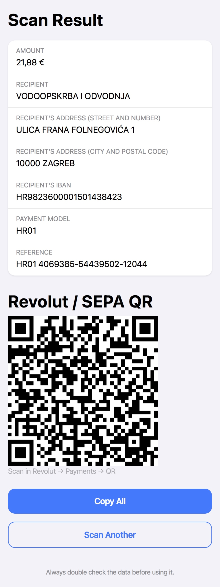

# Croatian Invoice Barcode Scanner

Live version: https://bara82.github.io/hr-barcode-scanner-web/.

Scans or import from image and interprets Croatian invoice barcodes (PDF417 barcodes with HUB-3 data format). Works best with a good smartphone camera.

Barcodes are decoded using [zxing-wasm](https://github.com/Sec-ant/zxing-wasm) (ZXing-C++ compiled to WebAssembly). Accuracy is not guaranteed and results may vary depending on input quality. It generates a QR code in EPC / SEPA format (for example for the Revolut app) using [qrcode-generator](https://github.com/kazuhikoarase/qrcode-generator) (MIT). Both libraries are vendored in `assets/`, so the app works without any CDN.

After a scan the app also checks the data and shows a warning if something looks wrong (it never blocks the result):

- IBAN checksum (ISO 13616)
- payment model and reference control digits for models HR01–HR11 (MOD11INI) and ISO 11649 `RF` references
- header (`HRVHUB30`), currency (`EUR`), amount

Other payment models are not verified. Always double check the data before paying.

## Example

Example scan of a barcode from the [HUB-3 specification](https://hub.hr/sites/default/files/inline-files/2DBK_EUR_Uputa_0.pdf):



## Development

The app is a static page: open `index.html` through any web server (the camera needs HTTPS or `localhost`; `python3 -m http.server` is enough).

The logic that does not touch the page (validation, EPC payload, amount, encoding) lives in `assets/hub3.js` and is covered by tests:

```
npm install
npm test
```

`tests/hub3.test.js` is dependency-free. `tests/roundtrip.test.js` renders a real HUB-3 PDF417, decodes it, builds the EPC payload, renders the QR and decodes that again, with Croatian diacritics.
